

  

<h1 align="center">MAY - Task Manager</h1>

  <strong>Make Android Yours: Gerenciador avançado de tarefas, telemetria de hardware em tempo real, diagnóstico de bateria, monitoramento de rede e controle profundo de processos para Android via Superusuário / Root.</strong>

  
  
  
  

  
  
  
  
  
  
  

  <a href="#visao-geral">Visão Geral</a> •
  <a href="#telas-do-aplicativo">Telas</a> •
  <a href="#modulos-do-sistema">Módulos</a> •
  <a href="#recursos-para-superusuario">Superusuário</a> •
  <a href="#temas-e-liquid-glass">Temas</a> •
  <a href="#sistema-de-atualizacoes-e-canal-beta">Atualizações & Beta</a> •
  <a href="#download">Download</a> •
  <a href="#creditos">Créditos</a> •
  <a href="#licenca">Licença</a>

---

## Visao Geral

O **MAY Task Manager** (Make Android Yours) é um aplicativo dedicado ao monitoramento, análise e otimização avançada do sistema Android. Tudo que você esperaria de um gerenciador de tarefas de desktop, agora no seu smartphone.

O aplicativo funciona é focado em aparelhos rooteados (Superuser / su), liberando controles diretos sobre o kernel.

---

## Telas do Aplicativo

  Visão resumida das principais telas do MAY Task Manager.

| **1. Processos** | **2. Desempenho** | **3. Histórico Diário** |
|:---:|:---:|:---:|
| <a href="docs/screenshots/01_processos.png">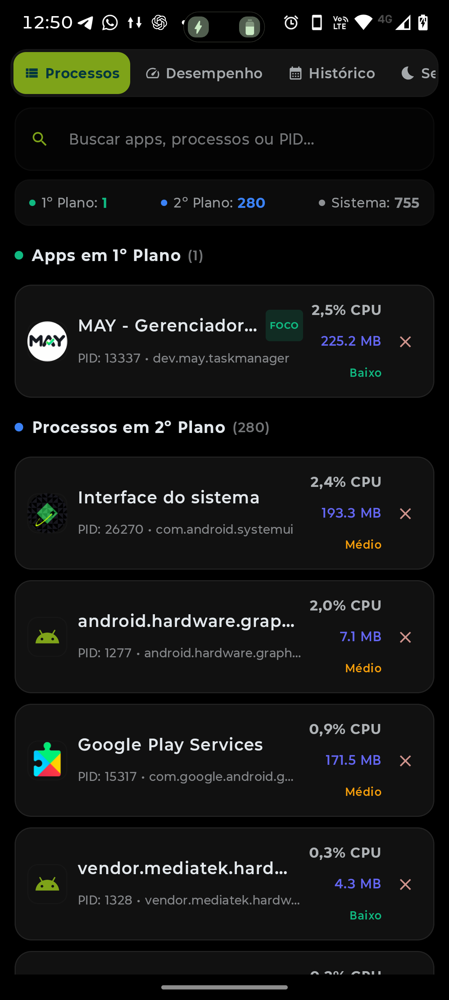</a> | <a href="docs/screenshots/02_desempenho.png">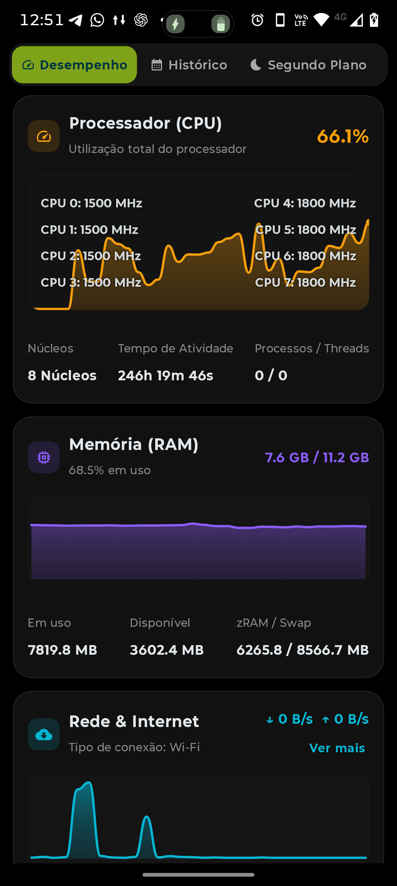</a> | <a href="docs/screenshots/03_historico.png">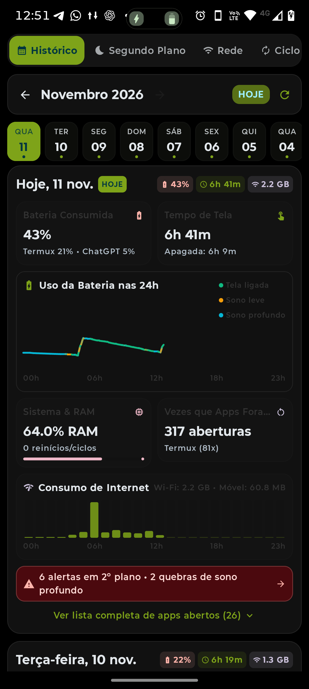</a> |
| Gestão cirúrgica de apps em 1º/2º plano e sistema com CPU e RAM | Frequências por núcleo, governadores e gráficos de CPU/RAM | Linha do tempo, consumo 24h, sono leve/profundo e aberturas |

| **4. Segundo Plano** | **5. Rede & Notificação** | **6. Ciclos de Bateria** |
|:---:|:---:|:---:|
| <a href="docs/screenshots/04_segundo_plano.png">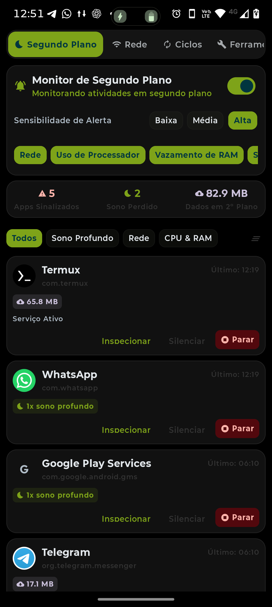</a> | <a href="docs/screenshots/05_rede_config.png">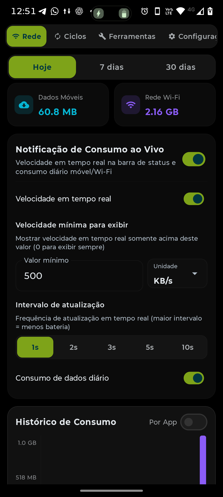</a> | <a href="docs/screenshots/06_ciclos_bateria.png">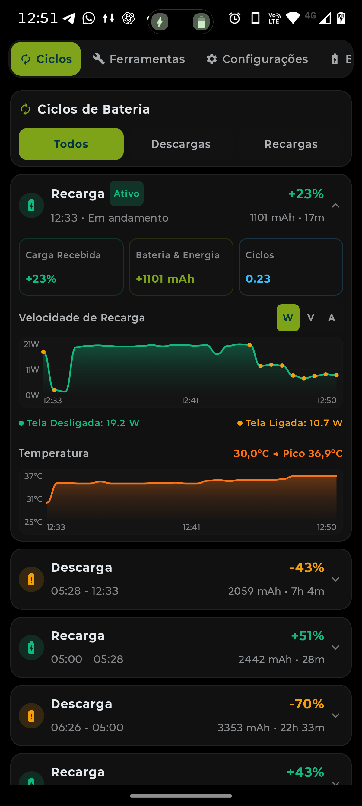</a> |
| Detector de anomalias, consumo em repouso e quebras de sono | Velocidade na barra de status, limites mínimos e amostragem | Curva de velocidade de recarga (Watts), temperatura e histórico |

| **7. Ferramentas** | **8. Configurações** | **9. Diagnóstico de Bateria** |
|:---:|:---:|:---:|
| <a href="docs/screenshots/07_ferramentas.png">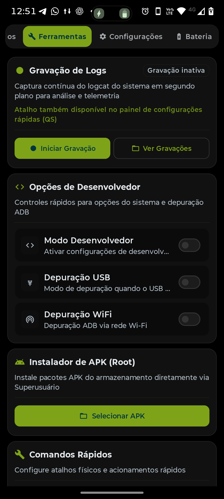</a> | <a href="docs/screenshots/08_configuracoes.png">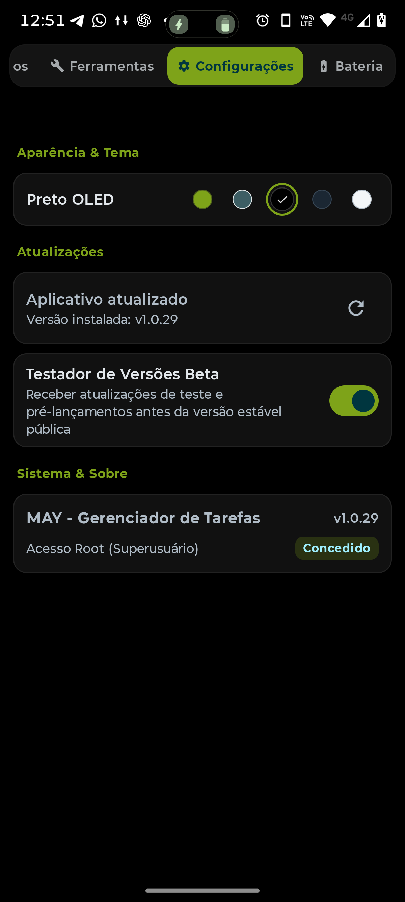</a> | <a href="docs/screenshots/09_bateria_visao_geral.png">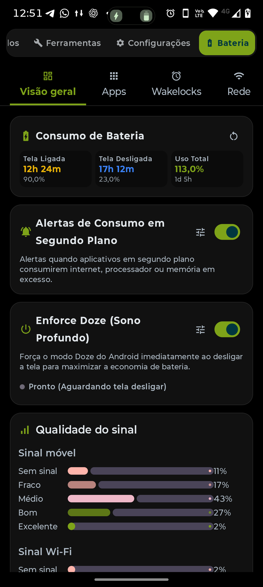</a> |
| Gravação de logs com atalho QS, depuração e instalador root | Seleção de temas, atualizador embutido e canal beta | Tempo de tela ligada/apagada, Enforce Doze e qualidade de sinal |

| **10. Tráfego por App** | **11. Estatísticas Root** | **12. Zonas Térmicas** |
|:---:|:---:|:---:|
| <a href="docs/screenshots/10_rede_consumo_apps.png">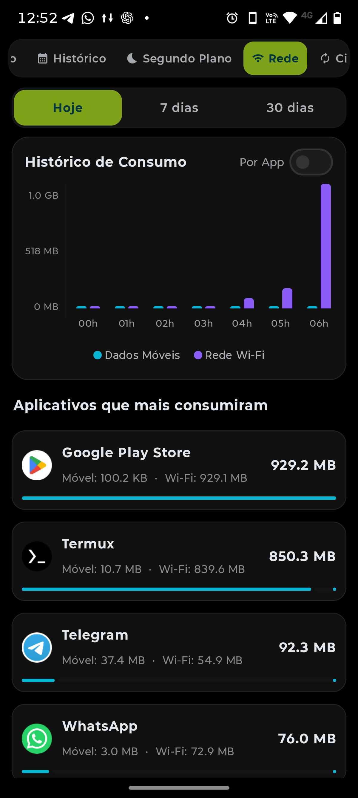</a> | <a href="docs/screenshots/11_bateria_root_status.png">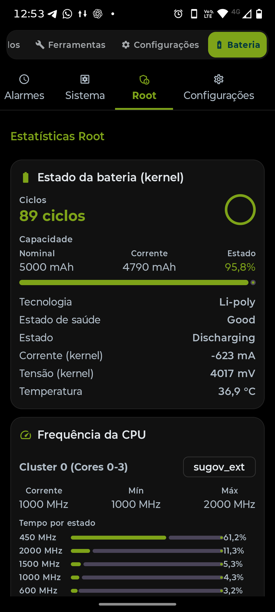</a> | <a href="docs/screenshots/12_frequencias_termicas.png">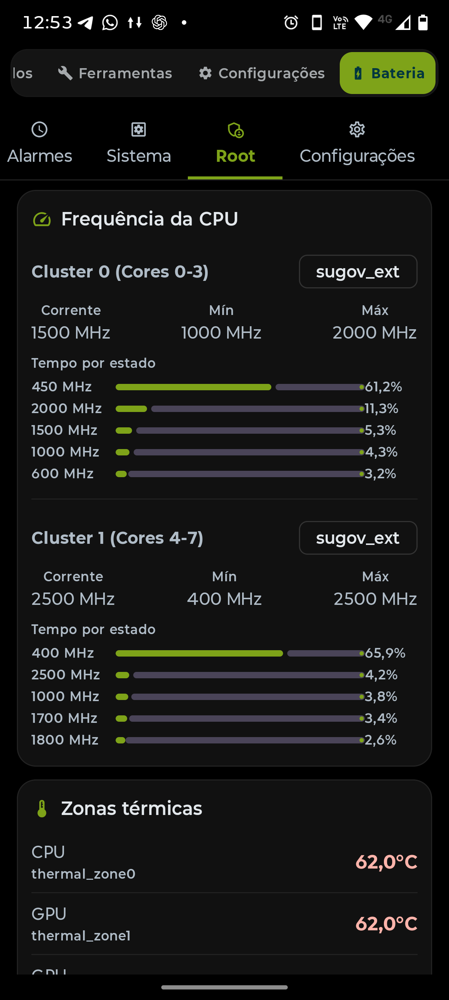</a> |
| Ranking dos aplicativos que mais consumiram internet no dia | Capacidade nominal vs real, contagem de ciclos e tensão mV | Distribuição de tempo por estado da CPU e sensores térmicos |

---

## Modulos do Sistema

### 1. Processos (Processes)
- Listagem segmentada em tempo real: Aplicativos em Primeiro Plano (*Foreground*), Serviços em Segundo Plano (*Background*) e Processos de Sistema (*System*).
- Busca instantânea por nome ou pacote.
- Inspeção em um toque com detalhes de PID, UID, uso de memória PSS, tempo de execução e estado de ciclo de vida.
- Ações rápidas de encerramento, abertura de configurações do sistema e exportação de diagnóstico.

### 2. Desempenho (Performance)
- Monitor em tempo real de núcleos da CPU (frequências atuais, limites mínimos e máximos por cluster).
- Gráficos contínuos de CPU, memória RAM, taxa de escrita/leitura em armazenamento e taxas de transferência de rede.
- Sensores térmicos por zona do hardware (bateria, CPU, modem, placa-mãe).

### 3. Historico Diario (Daily History)
- Consolidação diária de métricas de uso: tempo de tela, tempo em repouso, ciclos de carga, consumo agregado de bateria e abertura de aplicativos.
- Gráficos de tráfego de dados por hora e registro de quebras de sono profundo causadas por processos em segundo plano.

### 4. Ciclos de Bateria (Cycles)
- Rastreamento dos ciclos de carga e descarga com cálculo de porcentagem consumida, duração de cada evento e taxa horária de drenagem (%/h).

### 5. Monitor de Rede (Network)
- Estatísticas detalhadas de consumo de dados por interface (Wi-Fi e Dados Móveis).
  - Identificação de pacotes ativos em segundo plano gerando tráfego.

### 6. Diagnostico de Bateria e Doze (Battery)
- Análise de consumo detalhada via `dumpsys batterystats`.
- Painel Enforce Doze: força a suspensão profunda imediatamente após o bloqueio de tela.

### 7. Detector de Anomalias (Background Watcher)
- Monitor de repouso configurável para alertar o usuário quando algum app exceder o limiar de consumo de processamento ou acordar o dispositivo excessivamente.
- Histórico de incidentes com registro de hora, aplicativo ofensor, severidade e métrica excedida.

---

## Recursos para Superusuario

O MAY Task Manager é funcional em dispositivos sem root (utilizando APIs padrão do Android, TrafficStats, UsageStats e NetworkStatsManager). Contudo, a presença de Superuser habilita um conjunto avançado de operações de baixo nível.

---

## Temas

  

A tela de configurações do MAY conta com seletor de temas com:

- **Liquid Glass:** Efeito de vidro líquido translúcido.
- **Monet Dinamico:** Extração inteligente da paleta tonal do wallpaper do usuário através da biblioteca Material You.
- **OLED Escuro:** Fundo `#000000` absoluto com elementos de alto contraste para economia máxima em telas AMOLED.
- **Modern Dark:** Tons modernos de cinza escuro e superfícies suaves para uso noturno confortável.
- **Light Clean:** Tema claro com alto contraste.

---

## Sistema de Atualizacoes e Canal Beta

O MAY Task Manager inclui um mecanismo integrado de entrega contínua através do GitHub Releases:

- **Canal de Versoes Beta:** O usuário pode ativar a opção **Testador de Versões Beta** nas configurações para receber versões preliminares e experimentais antes do lançamento público geral.
- **Instalacao Silenciosa:** Em dispositivos com Superuser, o processo de download, validação de integridade e instalação do APK é realizado de maneira totalmente silenciosa e transparente.

---

## Requisitos de Sistema

- **Versao Minima do Android:** Android 8.0 (API 26) Oreo ou superior.
- **Versao Alvo:** Android 15 (API 35).
- **Arquiteturas Suportadas:** arm64-v8a, armeabi-v7a, x86, x86_64.
- **Privilegios de Superusuario:** Opcional (habilita telemetria avançada, inspeção irrestrita e comandos de kernel).

---

## Download

Os arquivos de instalação (APK) oficiais podem ser obtidos na aba de lançamentos do projeto:

- **[Releases Oficiais no GitHub](https://github.com/S-Marcos-S/MAY---Task-Manager/releases)**
- **[Ultima Versao Estavel](https://github.com/S-Marcos-S/MAY---Task-Manager/releases/latest)**

---

## Compilacao e Otimizacao

O projeto é configurado com compilação automatizada via GitHub Actions com otimizações:

- **Compilador:** Kotlin 2.0+ com plugin Compose.
- **Minificacao:** R8 habilitado com ofuscação, remoção de classes e métodos inacessíveis, além de empacotamento compacto de pacotes.
- **Shrinking de Recursos:** Remoção automática de recursos não utilizados para gerar um APK de tamanho mínimo.

---

## Creditos

- **[BatStats](https://github.com/mlm-games/BatStats)**: Inspiracao para o modulo de diagnostico e metricas de bateria.

---

## Licenca

Este projeto é software livre e de código aberto, distribuído sob os termos da licença **GNU General Public License v3.0 (GPL-3.0)**. Consulte o arquivo [LICENSE](LICENSE) para obter o texto completo da licença.
